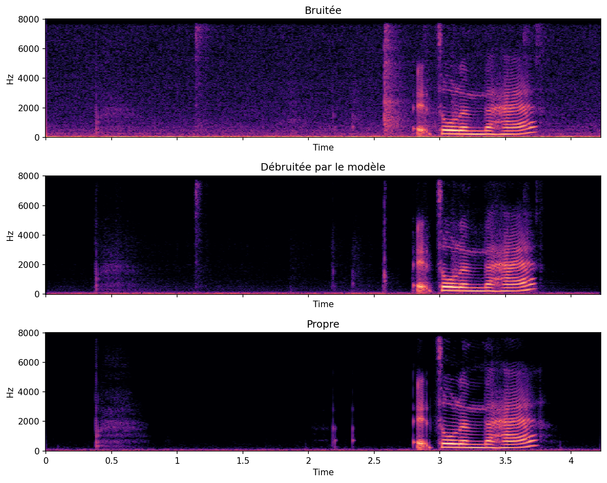
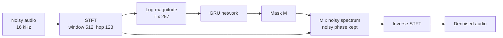

# Real-Time Speech Denoising with a Lightweight GRU

A small recurrent neural network that removes background noise from speech, trained in TensorFlow/Keras and deployed with TensorFlow Lite (int8). It runs about **90x faster than real time** on a single CPU thread while staying under **2 MB**.

| | SNR (dB) | PESQ (wb) | STOI |
|---|---|---|---|
| Noisy input | 8.45 | 1.97 | 0.922 |
| **This model** | **17.43** | **2.71** | **0.940** |
| Oracle mask (upper bound of the method) | 19.76 | 3.89 | 0.987 |

*Averages over the 824 clips of the VoiceBank-DEMAND test set. The noisy-input values match the reference values commonly reported for this dataset, which validates the evaluation pipeline.*

---

## Demo



*Test clip 588: input SNR -3.1 dB (the noise is louder than the voice), output SNR 15.6 dB.*

Listen to the examples (noisy / denoised / clean):

| Clip | Noisy | Denoised | Clean |
|---|---|---|---|
| 588 (hardest) | [noisy](examples/clip588_1_bruite.wav) | [denoised](examples/clip588_2_debruite.wav) | [clean](examples/clip588_3_propre.wav) |
| 680 | [noisy](examples/clip680_1_bruite.wav) | [denoised](examples/clip680_2_debruite.wav) | [clean](examples/clip680_3_propre.wav) |
| 0 | [noisy](examples/clip0_1_bruite.wav) | [denoised](examples/clip0_2_debruite.wav) | [clean](examples/clip0_3_propre.wav) |

Headphones recommended: most of the removed noise is in the low frequencies.

---

## How it works

The network does not generate speech. It predicts a **time-frequency mask**: for every cell of the spectrogram, a value between 0 (remove) and 1 (keep). Everything else is classic signal processing.



- **STFT:** 32 ms Hann windows (512 samples at 16 kHz) with an 8 ms hop (128 samples), giving 257 frequency bins per frame.
- **Input features:** log-magnitude of the noisy spectrogram, normalized per frequency bin.
- **Output:** a sigmoid mask applied to the noisy magnitude; the noisy phase is reused for reconstruction.
- **Oracle mask:** computed from the clean signal (`min(1, |S| / |X|)`), it gives the best result this masking approach could reach and is used as an upper bound.

### Model

| Layer | Output | Parameters |
|---|---|---|
| Input (log-magnitude) | (T, 257) | 0 |
| Normalization | (T, 257) | 515 (non-trainable) |
| Dense 256, ReLU | (T, 256) | 66,048 |
| GRU 256 | (T, 256) | 394,752 |
| GRU 256 | (T, 256) | 394,752 |
| Dense 257, sigmoid (mask) | (T, 257) | 66,049 |
| **Total** | | **921,601 trainable** |

The GRUs are unidirectional, so the model is **causal**: each output frame depends only on past frames, which makes frame-by-frame real-time processing possible. The STFT window sets a minimum algorithmic latency of 32 ms.

### Training

- **Data:** VoiceBank-DEMAND at 16 kHz, 11,572 training clips (9.4 h). The last 500 clips (unseen speakers) are held out for validation; the 824 test clips are only used for the final evaluation.
- **Batches:** 32 random 2-second segments, STFT computed on the fly in a `tf.data` pipeline.
- **Loss:** MSE between power-law compressed magnitudes, which gives more weight to quiet sounds, closer to human hearing:

  `L = mean( (|M·X|^0.3 - |S|^0.3)^2 )`

- **Optimizer:** Adam (lr 1e-3, gradient clipping 1.0), learning rate halved on plateau, early stopping. Best model at epoch 17 (val loss 0.0095), on a free Google Colab GPU.

---

## Deployment: TensorFlow Lite

| Version | Size | Latency per 1.02 s block | Per frame | RTF | PESQ (100 clips) |
|---|---|---|---|---|---|
| Keras (reference) | 3.5 MB of weights | 20.1 ms* | 0.16 ms | 0.020 | 2.78 |
| TFLite float32 | 4.52 MB | 36.5 ms | 0.29 ms | 0.036 | 2.67 |
| **TFLite int8** | **1.81 MB** | **11.6 ms** | **0.09 ms** | **0.011** | **2.66** |

*Measured on Google Colab, TFLite with 1 CPU thread; timings vary a little from run to run (an earlier run gave 23.5 ms for int8). \*The Keras timing likely ran on GPU and is not directly comparable. RTF = processing time / audio duration; below 1 means faster than real time.*

- **int8 quantization** makes the model 2.5x smaller and about 3x faster than float32 with no measurable quality loss.
- **The PESQ drop from Keras to TFLite (-0.11) comes from block processing**, not from the conversion: float32 and int8 give the same score. Each 1-second block restarts the GRUs with an empty state. A streaming version that carries the GRU state between blocks would remove this loss.
- **Porting notes:**
  - The GRUs trained on GPU used cuDNN kernels, which TFLite cannot convert. The model was rebuilt with standard GRU cells (`use_cudnn=False`), a fixed input size and an unrolled time loop, then the trained weights were copied over.
  - The rebuilt model was checked against the original before conversion. A first check showed a max difference of 0.95 on the mask: the normalization statistics had not been transferred. After recomputing them, the difference dropped to about 3e-7.

---

## Analysis

**What works**
- Diffuse background noise is strongly reduced, especially during pauses, and voiced speech (harmonics) and fricatives are well preserved.
- The model recovers about 80% of the SNR gain reachable with an ideal mask, with under 1M parameters.

**Limitations**
- Perceived quality (PESQ) recovers only about 39% of the oracle gain: some quiet speech buried in noise is attenuated, and some short impulsive noises are kept.
- The noisy phase is reused, which limits the achievable quality and can leave light "musical noise" artifacts.

**Next steps**
- Stateful streaming inference (frame by frame, GRU state preserved).
- Complex masks or phase-aware models to go beyond magnitude masking.
- Migration from `tf.lite.Interpreter` to LiteRT (`ai_edge_litert`), and latency measurements on an ARM device.
- More noise types and data augmentation.

---

## Repository structure

```
speech-denoiser/
├── speech_denoiser.ipynb      # full pipeline: data, training, evaluation, TFLite
├── models/
│   └── denoiser_int8.tflite   # deployed model (1.81 MB)
├── examples/                  # audio examples and spectrograms
└── results/
    └── results_test.csv       # per-clip SNR, PESQ, STOI on the test set
```

## Reproduce

Open `speech_denoiser.ipynb` in Google Colab with a GPU runtime and run the cells in order. Main dependencies: `tensorflow`, `datasets`, `soundfile`, `librosa`, `pesq`, `pystoi`.

## Data and credits

- **Dataset:** VoiceBank-DEMAND (Valentini-Botinhao et al., 2016), used through the 16 kHz Hugging Face mirror [JacobLinCool/VoiceBank-DEMAND-16k](https://huggingface.co/datasets/JacobLinCool/VoiceBank-DEMAND-16k), CC BY 4.0.
- **Metrics:** PESQ (ITU-T P.862, wideband) via `pesq`, STOI via `pystoi`.

## Author

Angy Lemesley Dufraisse, final-year Audiovisual Systems Engineering student at Universitat Pompeu Fabra. [LinkedIn](https://www.linkedin.com/in/angy-lemesley)
